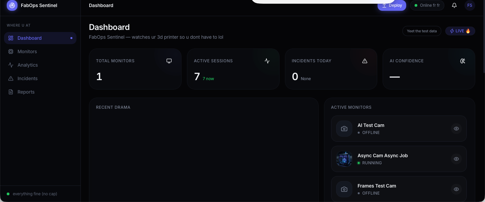

# FabOps Sentinel

FabOps Sentinel watches a 3D printer, laser cutter, or CNC machine through a webcam, sends every frame to a vision model, and texts you when a part goes wrong, for anyone running a print farm or a laser cutter who wants an alert instead of a babysitter.

```sh
docker compose up --build
```



The capture above is the dashboard with a seeded demo session. The vision verdicts need an API key, so the feed reads "everything fine" rather than a real warning. [docs/demo.md](docs/demo.md) has the full steps, including the one frame analysis that fills the feed with a real verdict.

## How it works

A camera watches the machine. When you start monitoring a job from the dashboard, the capture loop grabs a frame every few seconds and posts it to `POST /api/frames/analyze`. The backend sends that frame along with your reference images of good and failed prints to an OpenAI-compatible vision API, stores the verdict, and fires a Twilio SMS when the result is a warning or stop. Warning and stop verdicts also open an incident and save the frame under `backend/captured_frames/`. The dashboard polls the API, so live status, incidents, analytics, and reports stay current without holding a socket. "Analyze Now" runs one analysis on demand.

## Run it

The stack needs a completed `backend/.env` before it starts. Copy the template first, then bring it up:

```sh
cp backend/.env.example backend/.env
docker compose up --build
docker compose exec ollama ollama pull llava
```

Compose starts the backend on port 8000, the Vite frontend on 5173, the dashboard on 3000, and Ollama on 11434. Twilio keys are optional; the SMS path turns itself off when they are absent.

The backend talks to the `ollama` service over `OPENAI_BASE_URL=http://ollama:11434/v1`, which compose sets for you. The pull in the third line is the one manual step: the container has no model until you fetch one, and `llava` is the default name the backend asks for. `llama3.2-vision` and `qwen2.5vl` work too, but pull the same name you give `OPENAI_MODEL`.

JavaScript commands in this file use bun. The repo's AGENTS.md and CI workflow still call npm, and both read the same `package.json` scripts.

### Prerequisites

- Python 3.12+ for the backend, Node.js 20+ for the two JavaScript surfaces
- A webcam (built-in or USB) pointed at the machine
- An OpenAI-compatible vision endpoint: a hosted provider and its API key (EAON, OpenAI, Groq), or a local [Ollama](https://ollama.com) with a vision model pulled

### Backend

```sh
cd backend
python3 -m venv venv
source venv/bin/activate
pip install -r requirements.txt
cp .env.example .env
uvicorn main:app --reload
```

The API runs at `http://localhost:8000`, Swagger docs at `http://localhost:8000/docs`.

Edit `.env` (it is git-ignored; `.env.example` is the template, never commit real keys):

| Variable | Required | Description |
|---|---|---|
| `OPENAI_BASE_URL` | yes | Provider endpoint, e.g. `https://api.eaon.dev/v1` or `http://localhost:11434/v1` |
| `OPENAI_MODEL` | yes | Model name, e.g. `gpt-4o-mini`, `gemini-3.1-flash-lite`, or `llava` |
| `OPENAI_API_KEY` | hosted only | Key for your vision provider. Not needed for a local endpoint |
| `FABOPS_API_TOKEN` | recommended | Any long random string. Enables bearer auth on all `/api` routes |
| `VITE_FABOPS_API_TOKEN` | with token auth | Same value, exposed to the Vite frontend so its API client sends the bearer header |
| `NEXT_PUBLIC_FABOPS_API_TOKEN` | with token auth | Same value for the Next.js dashboard's API client |
| `TWILIO_ACCOUNT_SID`, `TWILIO_API_KEY_SID`, `TWILIO_API_KEY_SECRET`, `TWILIO_PHONE_NUMBER`, `ALERT_PHONE_NUMBER` | no | Twilio SMS alerts |

A note on security: with `FABOPS_API_TOKEN` set, every `/api` route requires an `Authorization: Bearer <your-token>` header (`/api/health` excepted). Without a token configured, the API only serves loopback clients and rejects everything else with a `503`, so an accidentally exposed port is not an open API. The `/api/debug/*` routes stay disabled unless you set `FABOPS_DEBUG=1`. Frame analysis is rate limited per client at 10 requests per minute by default, tunable with `ANALYZE_RATE_LIMIT_PER_MINUTE`.

### Local vision

The vision call is plain OpenAI chat completions, so any server that speaks that shape works, including Ollama. Ollama wants the same `image_url` parts with base64 data URLs that a hosted provider gets, so the only change is the endpoint and the model name.

```sh
ollama serve
ollama pull llava          # or llama3.2-vision, qwen2.5vl
```

```sh
# backend/.env
OPENAI_BASE_URL=http://localhost:11434/v1
OPENAI_MODEL=llava
OPENAI_API_KEY=
```

A local endpoint needs no key. `services/vision.py` skips the key requirement when the endpoint is loopback, a private address, or a single-label hostname like the compose service, and the effective base URL, model, and key come from `resolve_vision_config` rather than from `getenv` sprinkled through the module. `docker compose up` already points the backend at its own `ollama` service, so a compose run needs only the pull. To confirm what the backend resolved, run it with `FABOPS_DEBUG=1` and open `GET /api/debug/env`.

### Dashboard

```sh
cd dashboard
bun install
bun run dev
```

Open `http://localhost:3000`. Add a machine (3D printer, laser cutter, CNC, or generic camera), click "Watch It" to start a monitoring session, and point the webcam at the machine. Frames get analyzed automatically while the session is active, or click "Analyze Now" for a manual check.

### Alternate frontend

There is also a smaller React Router app under `frontend/` that proxies `/api` calls to the backend:

```sh
cd frontend
bun install
bun run dev
```

It serves `http://localhost:5173`.

## Privacy

Where frames go depends on `OPENAI_BASE_URL`.

- Local endpoint (loopback, a private address, or the compose `ollama` service): no frame leaves the machine or your own network. The live frame, the twelve reference images, and the prompt all go to the local model.
- Hosted endpoint (OpenAI, EAON, Groq, anything on the internet): every frame leaves the machine. Each analysis uploads the live frame plus all twelve reference images to that provider. The capture loop runs every 3 seconds by default and `ANALYZE_RATE_LIMIT_PER_MINUTE` caps analysis at 10 per minute, so a monitored job can put up to 600 uploads an hour on the wire.

Two things stay on local disk either way: `backend/.env` holds the key and is git-ignored, and `backend/captured_frames/` keeps the frames that triggered a warning or stop.

## What it does not do yet

- It compares one frame at a time against reference images. Nothing tracks print state across frames, so a slow failure that looks fine in any single frame goes unseen.
- Detection quality comes from the reference set in `backend/reference_images/`. The stock images catch obvious spaghetti and miss subtler failures on your specific printer or material.
- Every analysis is a network call to a vision provider. With a hosted one it is a paid call that needs `OPENAI_API_KEY`. With a local one there is no key and no fee, but the verdict is only as good as the model you pulled.
- Auth is one shared bearer token and storage is SQLite. It is built for local and demo use, not for exposure to the open internet.
- The Next.js dashboard has no automated tests. The backend has a pytest suite and the Vite frontend has vitest coverage.

## How it compares

The obvious alternative is a YOLO or OpenCV detector you train on your own failure photos. That pipeline is faster per frame and runs offline, because the model does inference on your machine with no network round trip and no per-frame fee. A commercial print-farm monitor goes further, with trained failure models, fleet views, and industrial camera support. The trade is setup work for reliability. There is no training set to label, and you change behavior by dropping a reference photo into `backend/reference_images/` or editing a prompt in `services/vision.py` instead of retraining a model.

## Project structure

```
backend/                        # Python FastAPI backend
├── main.py                     # Server entry point, routes, CORS
├── auth.py                     # Bearer token middleware
├── rate_limit.py               # Per-client rate limiting for paid AI endpoints
├── .env.example                # Template for environment variables
├── database/
│   ├── db.py                   # SQLite connection & init
│   └── schema.sql              # Table definitions
├── models/
│   └── schemas.py              # Pydantic request/response models
├── routers/
│   ├── frames.py               # Frame analysis (sync and async)
│   ├── jobs.py                 # Job management
│   ├── machines.py             # Machine CRUD
│   ├── reports.py              # Report generation
│   ├── seed.py                 # Demo data seeding/clearing
│   └── sessions.py             # Start/stop monitoring sessions
├── services/
│   ├── vision.py               # Calls the vision API
│   ├── notifications.py        # Twilio SMS alerts
│   └── reporting.py            # Report building
├── reference_images/           # Reference images for defect detection
├── requirements.txt
└── tests/                      # pytest suite

dashboard/                      # Next.js frontend
├── src/
│   ├── app/                    # Home, analytics, incidents, machines, reports
│   ├── components/
│   │   ├── camera/             # Live camera feed, capture, "Watch It"/"Analyze Now"
│   │   ├── dashboard/          # Widgets, charts, cards
│   │   ├── layout/             # Sidebar, header, notifications
│   │   └── ui/                 # Reusable shadcn-style components
│   ├── hooks/                  # use-api, use-polling
│   ├── lib/                    # API client, utils
│   └── types/                  # TypeScript type definitions
├── package.json
└── next.config.ts

frontend/                       # Alternate Vite + React Router UI
hardware/                       # Camera and rig notes
backend/fabops.db               # SQLite database, created at runtime
```

## API endpoints

| Method | Path | Description |
|---|---|---|
| `GET` | `/api/health` | Health check |
| `GET` | `/api/machines` | List all machines |
| `POST` | `/api/machines` | Create a machine |
| `GET` | `/api/machines/{id}` | Get machine details |
| `DELETE` | `/api/machines/{id}` | Delete a machine |
| `PATCH` | `/api/machines/{id}/status` | Update machine status |
| `GET` | `/api/jobs` | List jobs |
| `POST` | `/api/jobs` | Create a job |
| `GET` | `/api/jobs/{id}` | Get job details |
| `PATCH` | `/api/jobs/{id}/status` | Update job status |
| `POST` | `/api/frames/analyze` | Analyze a frame synchronously |
| `POST` | `/api/frames/analyze/async` | Queue an analysis, returns `202` |
| `GET` | `/api/frames/{job_id}` | List frames for a job |
| `GET` | `/api/frames/analysis/{analysis_id}` | Poll an async analysis result |
| `GET` | `/api/reports` | List reports |
| `GET` | `/api/reports/{job_id}` | Get report for a job |
| `POST` | `/api/sessions/start` | Start a monitoring session |
| `POST` | `/api/sessions/{job_id}/stop` | Stop a monitoring session |
| `POST` | `/api/seed/demo/{job_id}` | Fill a job with demo frames and incidents |
| `POST` | `/api/seed/clear` | Wipe all frames, incidents, jobs, and machines |

## Reference images

The `backend/reference_images/` folder holds the sample images the model compares against:

- Files with `error` or `spagheti` in the name are defect references (spaghetti, warping, etc.)
- Everything else counts as a good/normal print

Adding more of your own real failure photos is the easiest way to improve detection.

## Vision eval

`backend/eval/labels.tsv` labels every frame in `backend/reference_images/` as `normal` or `defect`, and `scripts/eval_vision.py` scores the vision call against them, so a prompt edit or a model swap can be measured instead of guessed.

```sh
backend/.venv/bin/python scripts/eval_vision.py --check
backend/.venv/bin/python scripts/eval_vision.py \
  --base-url http://localhost:11434/v1 --model llava
```

The script prints one line per frame, a per-label split, and overall accuracy. With no endpoint answering it prints one line and exits 2. `backend/eval/RESULTS.md` records what has actually been measured.

## SMS alerts (optional)

1. Sign up at [Twilio](https://console.twilio.com)
2. Get your Account SID, API Key SID, and API Key Secret
3. Add them to `.env`, plus `TWILIO_PHONE_NUMBER` (your Twilio number) and `ALERT_PHONE_NUMBER` (your cell)

When a `warning` or `stop` condition comes back from an analysis, you get a text. Repeat warnings on the same job are muted for 10 minutes; `stop` alerts always send.

## Running tests

```sh
# Backend (pytest is not in requirements.txt; install it once)
cd backend && pip install pytest && python -m pytest

# Dashboard
cd dashboard && bun install && bun run lint && bun run build

# Alternate frontend
cd frontend && bun install && bun test
```

## Tech stack

| Layer | Technology |
|---|---|
| Backend | Python, FastAPI, SQLite, httpx |
| Dashboard | Next.js (App Router), React, TypeScript, Tailwind CSS |
| Alternate frontend | Vite, React Router |
| AI | OpenAI-compatible vision API (EAON, OpenAI, Groq, etc.) |
| Alerts | Twilio SMS |

## Credits

Built by Ryan Bahadori with Shreeansh Bharadwaj and SansCreates.
